<!-- ═══════════════════════════════════════════════════════════
  AMLAN DEV — GITHUB PROFILE README
  Repo must be PUBLIC and named exactly: amlandevofficial
  Folder layout:  README.md  +  assets/ (all the .svg files)

  ⚠ BEFORE PUBLISHING: find & replace  YOUR_INSTAGRAM_HANDLE
    (it appears in several links in this file only)
═══════════════════════════════════════════════════════════ -->

  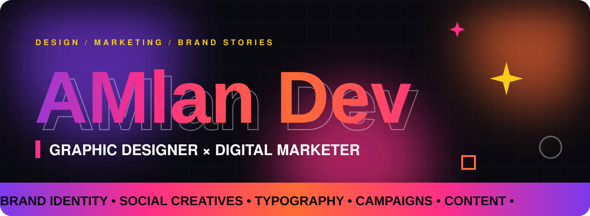

  

  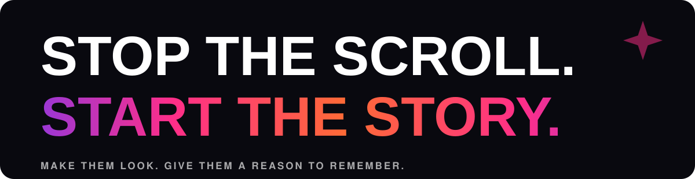

<b>Amlan Dev</b> is a graphic designer and digital marketer working where visual storytelling meets brand communication. 
Design earns the attention. Marketing gives it a direction.

  

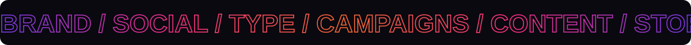

<!-- ───────────── 01 DISCIPLINES ───────────── -->

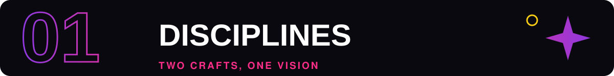

  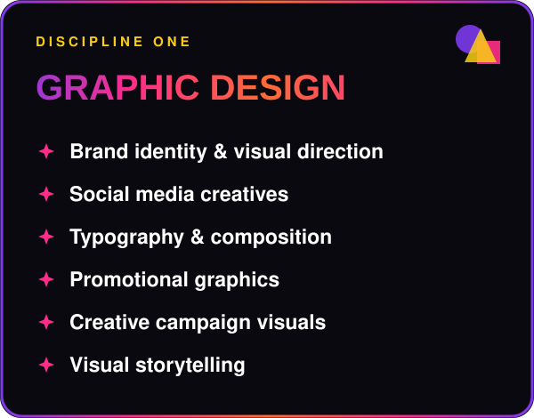
  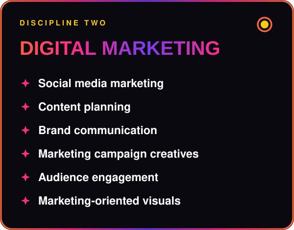

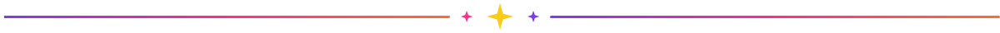

<!-- ───────────── 02 TOOLKIT ───────────── -->

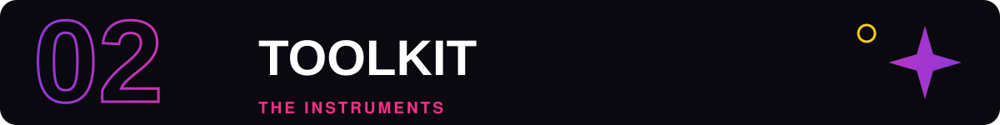

  <a href="https://www.adobe.com/products/photoshop.html">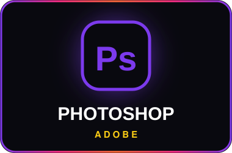</a>
  <a href="https://www.adobe.com/products/illustrator.html">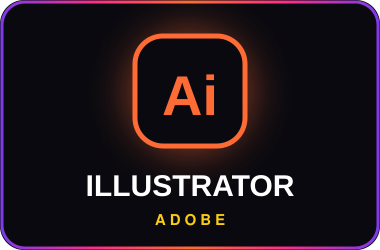</a>
  <a href="https://www.canva.com/">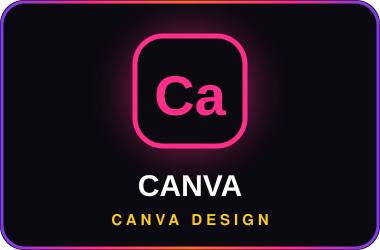</a>

Tools are the instrument. The idea is the work.

<!-- ───────────── 03 GALLERY ───────────── -->

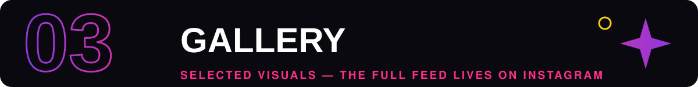

<!--
  HOW TO ADD YOUR OWN WORK
  1. Export a piece as JPG/PNG/GIF at 1200×800 px and upload it to /assets (e.g. assets/work-01.jpg).
  2. In the tile below, change  ./assets/tile_1.svg  to  ./assets/work-01.jpg
  3. Change the alt text to describe the piece. Keep the <a> link around it.
-->

  <a href="https://www.instagram.com/YOUR_INSTAGRAM_HANDLE/"></a>
  <a href="https://www.instagram.com/YOUR_INSTAGRAM_HANDLE/"></a>

  <a href="https://www.instagram.com/YOUR_INSTAGRAM_HANDLE/"></a>
  <a href="https://www.instagram.com/YOUR_INSTAGRAM_HANDLE/"></a>

  <a href="https://www.instagram.com/YOUR_INSTAGRAM_HANDLE/"></a>
  <a href="https://www.instagram.com/YOUR_INSTAGRAM_HANDLE/"></a>

<!-- ───────────── 04 APPROACH ───────────── -->

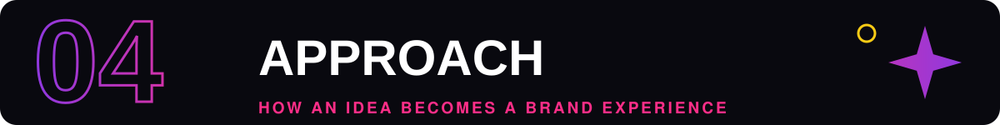

  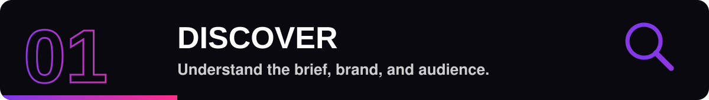 
  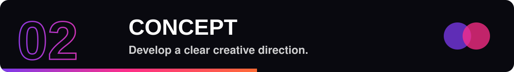 
  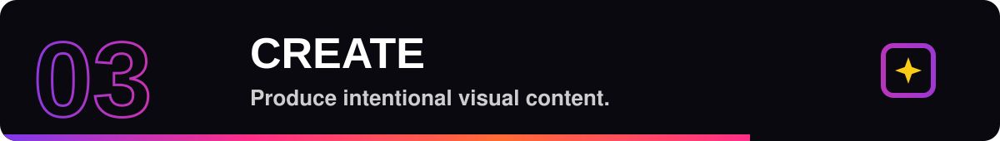 
  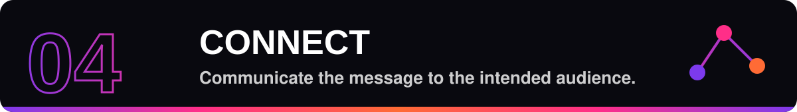

A creative approach, not a formula. Every brief shapes its own path.

<!-- ───────────── 05 CONNECT ───────────── -->

Open to conversations about 
<b>graphic design</b> · <b>brand identity</b> · <b>social media creatives</b> 
<b>digital marketing projects</b> · <b>creative collaborations</b>

  
  

  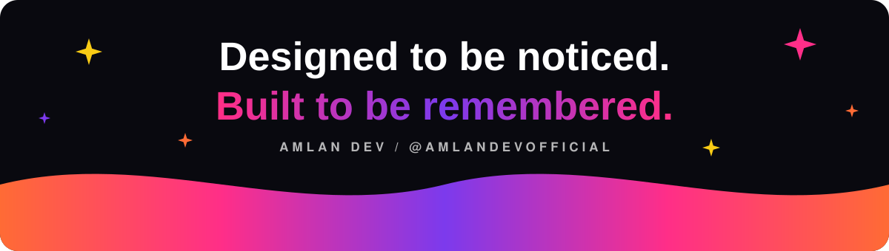

